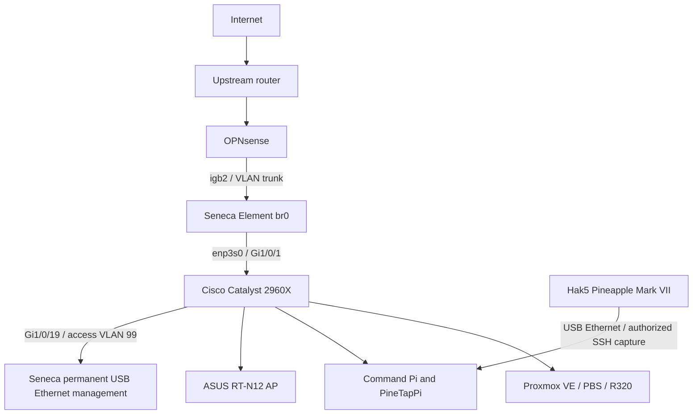

# Preferred Network Topology

Seneca built-in `enp2s0` connects toward OPNsense `igb2`; `enp3s0` toward Cisco `Gi1/0/1`. Both are transparent members of bridge `br0`; USB management stays separate. This diagram is the intended layout, not proof that every cable is currently connected.
